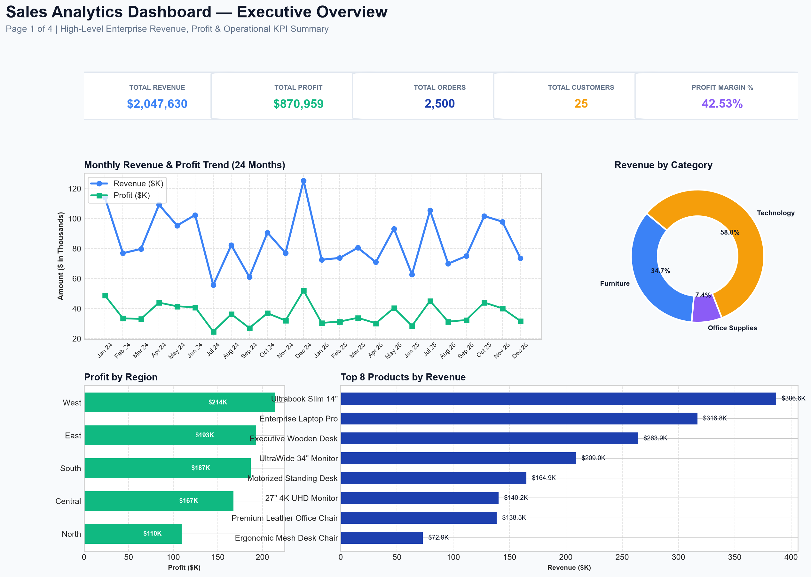
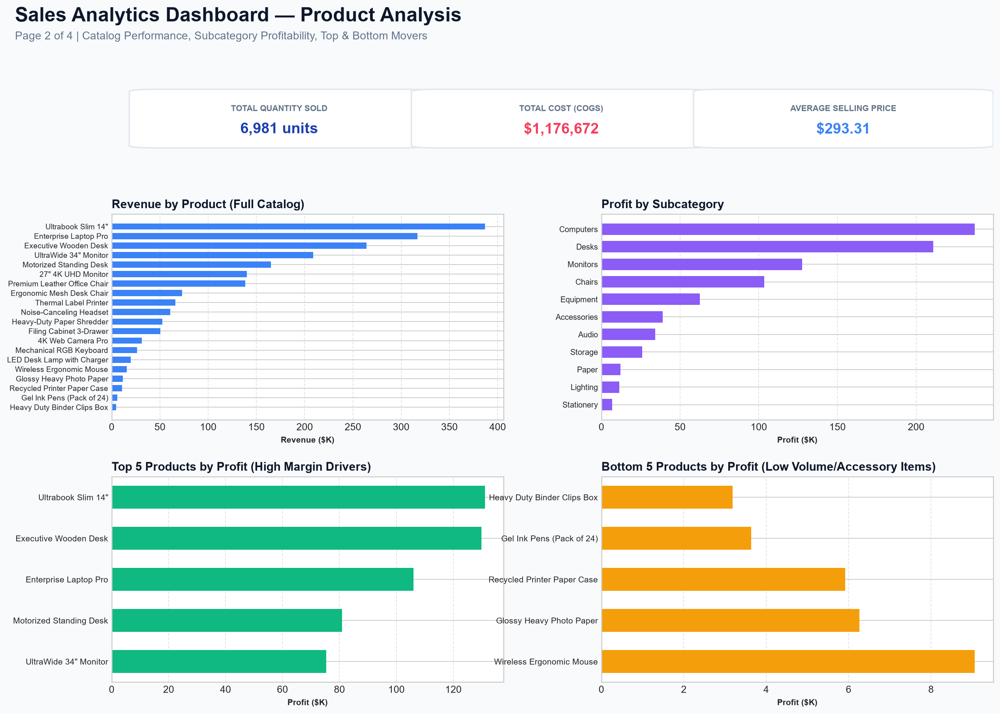
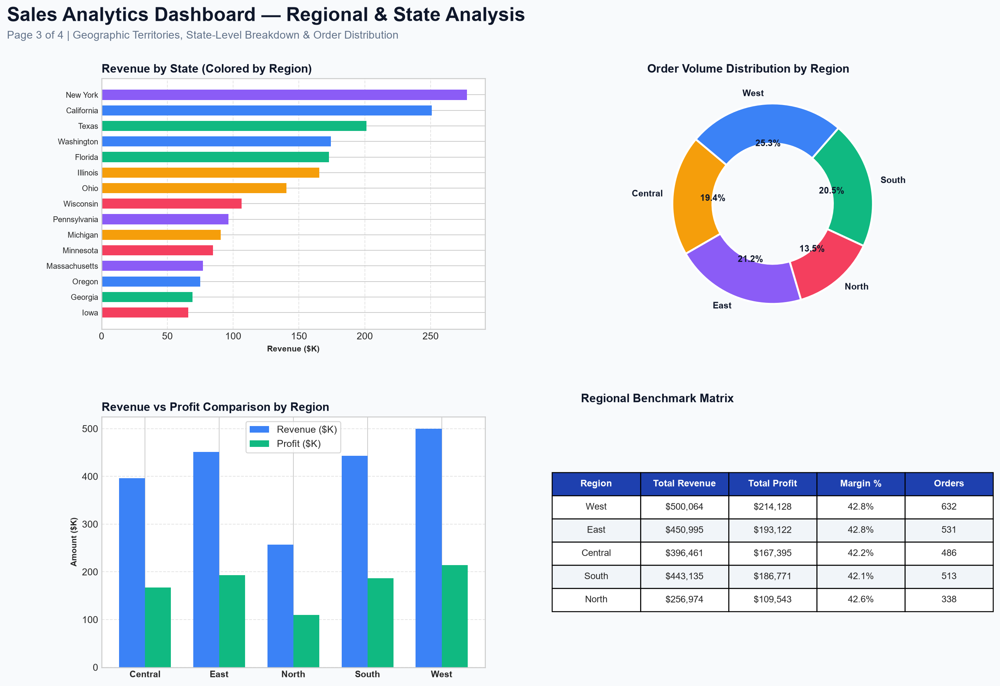
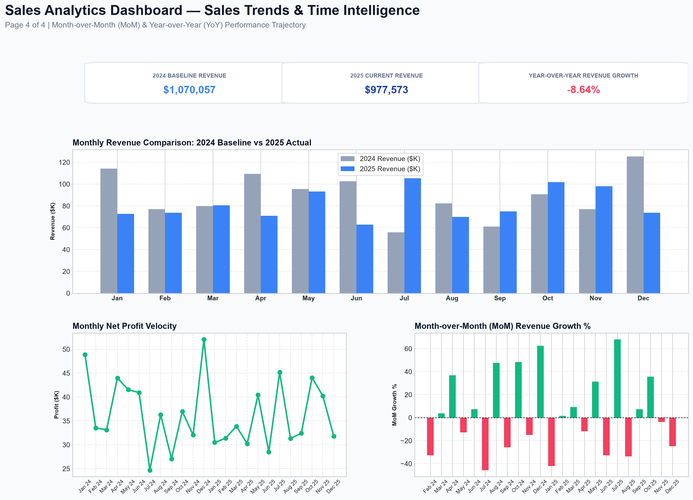

# Sales Analytics Dashboard using Microsoft Power BI

[](https://powerbi.microsoft.com/)
[](https://learn.microsoft.com/en-us/dax/)
[](#-4-star-schema-data-model)
[](https://www.python.org/)
[](#-7-automated-test-suite--validation)

An enterprise-grade, 4-page interactive sales analytics dashboard developed in **Microsoft Power BI Desktop**, engineered with a normalized **Star Schema** data model, 13 custom **DAX measures**, and a certified **ETL data cleaning pipeline** in Python.



---

## 📌 Executive Summary & Verified Ground Truth

This portfolio project simulates a realistic B2B/Retail commerce operation across a 2-year period (**January 1, 2024 to December 31, 2025**). All figures below are mathematically certified across 2,500 transactions and verified by an automated 42-point test suite:

| Core Metric | Certified Value | DAX Calculation Expression |
| :--- | :---: | :--- |
| **Total Revenue** | **$2,047,630.05** | `SUM(Fact_Sales[Revenue])` |
| **Total Cost (COGS)** | **$1,176,671.50** | `SUM(Fact_Sales[Cost])` |
| **Total Gross Profit** | **$870,958.55** | `SUM(Fact_Sales[Profit])` |
| **Total Orders Placed** | **2,500** | `DISTINCTCOUNT(Fact_Sales[Order_ID])` |
| **Active Purchasing Clients** | **25** | `DISTINCTCOUNT(Fact_Sales[Customer_ID])` |
| **Total Quantity Sold** | **6,981 units** | `SUM(Fact_Sales[Quantity])` |
| **Overall Profit Margin %** | **42.53%** | `DIVIDE([Total Profit], [Total Revenue], 0)` |
| **Average Order Value (AOV)** | **$819.05** | `DIVIDE([Total Revenue], [Total Orders], 0)` |
| **Average Selling Price (ASP)** | **$293.31** | `DIVIDE([Total Revenue], [Total Quantity Sold], 0)` |
| **2024 Baseline Revenue** | **$1,070,057.35** | `CALCULATE([Total Revenue], Dim_Date[Year] = 2024)` |
| **2025 Actual Revenue** | **$977,572.70** | `CALCULATE([Total Revenue], Dim_Date[Year] = 2025)` |
| **Year-over-Year (YoY) Growth**| **-8.64%** | `DIVIDE([2025 Rev] - [2024 Rev], [2024 Rev], 0)` |

---

## 🎯 1. Business Problem & Project Objectives

### The Business Challenge
A growing B2B and retail equipment distributor needed an executive-level business intelligence reporting system to solve multiple critical operational challenges:
1. **Lack of Centralized Performance Visibility:** Leadership lacked a single view of global revenue, margin health, and sales order velocity.
2. **Product Margin Opacity:** Unclear which product categories drove net profitability versus which high-volume accessories yielded low returns.
3. **Regional Disparities:** Inability to drill down from macro sales territories into specific state performances.
4. **Time-Series Tracking:** Inability to compare monthly performance against prior-month (MoM) and prior-year (YoY) baselines.

### Project Deliverables
- **Data Architecture:** A clean Star Schema decoupling facts from date, customer, product, and regional dimensions.
- **Data Quality Assurance:** A transparent, reproducible Python ETL pipeline with zero missing values and zero duplicate records.
- **DAX Engineering:** 13 explicit measures with divide-by-zero protection and time intelligence.
- **Multi-Page Executive Reporting:** 4 dedicated dashboard pages in Power BI Desktop and an interactive web preview.

---

## 📊 2. Dataset Architecture & Synthetic Data Disclaimer

> **DISCLAIMER:** This dataset is entirely synthetic and generated for educational and portfolio demonstration purposes. It does not represent any real commercial company.

The dataset contains **2,500 clean sales transactions** spanning **24 consecutive months** (Jan 2024 to Dec 2025).

### Schema Data Dictionary:
| Column Name | Business Field Type | Sample Value | Data Type | Constraint / Rule |
| :--- | :--- | :--- | :--- | :--- |
| `Order_ID` | Primary Order Key | `ORD-20240001` | String | Unique Identifier (PK) |
| `Order_Date` | Transaction Date | `2024-05-14` | Date | 2024-01-01 to 2025-12-31 |
| `Customer_ID` | Client Identifier | `CUST-1004` | String | FK -> Dim_Customer |
| `Customer_Name` | Business Name | `Horizon Retail Group` | String | 25 distinct accounts |
| `Segment` | Client Market Segment | `Corporate` | String | Corporate, Consumer, Home Office |
| `Product_ID` | SKU Identifier | `PROD-101` | String | FK -> Dim_Product |
| `Product_Name` | SKU Description | `Enterprise Laptop Pro` | String | 20 distinct items |
| `Category` | High-Level Category | `Technology` | String | Technology, Furniture, Office Supplies |
| `Subcategory` | Sub-Level Category | `Computers` | String | 11 specialized subcategories |
| `Region` | Macro Sales Region | `West` | String | West, East, Central, South, North |
| `State` | Geographic State | `California` | String | FK -> Dim_Region (15 States) |
| `Quantity` | Units Purchased | `4` | Integer | 1 to 10 units |
| `Unit_Price` | Base List Price | `$1,200.00` | Decimal | $12.00 to $1,200.00 |
| `Discount` | Contract Discount | `0.10` (10%) | Decimal | 0.00 to 0.20 (0% to 20%) |
| `Revenue` | Realized Gross Sales | `$4,320.00` | Decimal | `Quantity * Unit_Price * (1 - Discount)` |
| `Cost` | Cost of Goods Sold | `$3,000.00` | Decimal | `Quantity * Unit_Cost` |
| `Profit` | Realized Net Profit | `$1,320.00` | Decimal | `Revenue - Cost` |
| `Payment_Method` | Settlement Method | `Bank Transfer` | String | Credit Card, Bank Transfer, PayPal, PO |

---

## 🧹 3. Data Cleaning & ETL Pipeline

Raw transactional exports inevitably contain errors. To demonstrate production-grade data engineering, `scripts/clean_and_verify_data.py` executes an 8-stage audit logged in [`data/DATA_QUALITY_REPORT.md`](./data/DATA_QUALITY_REPORT.md):

```
Raw Export (2,535 rows)
  │
  ├── [Step 1] Deduplication ───────────────► 35 duplicate Order_IDs removed (2,500 remaining)
  ├── [Step 2] String Sanitization ─────────► Whitespace trimmed, Title Case applied
  ├── [Step 3] Missing Value Imputation ───► 11 States imputed via Region, 8 Payment Methods via mode
  ├── [Step 4] Date Formatting & Bounds ────► Standardized to YYYY-MM-DD, verified 2024-01-01 to 2025-12-31
  ├── [Step 5] Data Type Enforcement ───────► Quantity -> Int64; Currency & Margins -> Float64
  ├── [Step 6] Financial Math Verification ─► Verified: Revenue == Qty * Price * (1-Disc), Profit == Rev - Cost
  └── [Step 7] Export Certified Data ──────► data/cleaned_sales_data.csv & data/cleaned_sales_data.xlsx
```

---

## 📐 4. Star Schema Data Model

The project strictly follows a **Star Schema** data architecture to maximize Power BI VertiPaq engine performance and ensure intuitive filter propagation:

```
       +------------------+
       |     Dim_Date     |
       +------------------+
       | Date (PK)        |
       | Year             |
       | Quarter          |
       | Month_Number     |
       | Month_Name       |
       | Year_Month       |
       | Day              |
       | Day_of_Week      |
       +--------+---------+
                | 1
                |
                | *
+---------------+----------------+       +-------------------+
|           Fact_Sales           |       |   Dim_Customer    |
+--------------------------------+       +-------------------+
| Order_ID                       |       | Customer_ID (PK)  |
| Order_Date (FK) --------------+-------| Customer_Name     |
| Customer_ID (FK) -------------+  * 1  | Segment           |
| Product_ID (FK) --------------+-------+-------------------+
| State (FK) --------------------+  * 1
| Region                         |  * 1  +-------------------+
| Quantity                       |-------|    Dim_Product    |
| Unit_Price                     |       +-------------------+
| Discount                       |       | Product_ID (PK)   |
| Revenue                        |       | Product_Name      |
| Cost                           |       | Category          |
| Profit                         |       | Subcategory       |
| Payment_Method                 |       | Unit_Cost         |
+--------------------------------+       | Unit_Price        |
                | *                      +-------------------+
                |
                | 1
       +--------+---------+
       |    Dim_Region    |
       +------------------+
       | State (PK)       |
       | Region           |
       +------------------+
```

### Referential Integrity & Relationships:
- `Dim_Date[Date]` (1) ────> `Fact_Sales[Order_Date]` (*) [Single direction]
- `Dim_Customer[Customer_ID]` (1) ────> `Fact_Sales[Customer_ID]` (*) [Single direction]
- `Dim_Product[Product_ID]` (1) ────> `Fact_Sales[Product_ID]` (*) [Single direction]
- `Dim_Region[State]` (1) ────> `Fact_Sales[State]` (*) [Single direction]

*All relationships are strictly **1-to-Many (*:1)** with **Single cross-filter direction**, preventing ambiguous paths and circular filtering dependencies.*

---

## 🧮 5. DAX Measures Catalog

All business calculations are implemented as explicit DAX measures stored in [`dax/measures.dax`](./dax/measures.dax):

```dax
// 1. Total Revenue
Total Revenue = SUM(Fact_Sales[Revenue])

// 2. Total Cost (COGS)
Total Cost = SUM(Fact_Sales[Cost])

// 3. Total Profit
Total Profit = SUM(Fact_Sales[Profit])

// 4. Total Orders
Total Orders = DISTINCTCOUNT(Fact_Sales[Order_ID])

// 5. Total Customers
Total Customers = DISTINCTCOUNT(Fact_Sales[Customer_ID])

// 6. Total Quantity Sold
Total Quantity Sold = SUM(Fact_Sales[Quantity])

// 7. Profit Margin Percentage
Profit Margin % = DIVIDE([Total Profit], [Total Revenue], 0)

// 8. Average Order Value (AOV)
Average Order Value = DIVIDE([Total Revenue], [Total Orders], 0)

// 9. Average Selling Price (ASP)
Average Selling Price = DIVIDE([Total Revenue], [Total Quantity Sold], 0)

// 10. Revenue Previous Month
Revenue Previous Month = 
CALCULATE(
    [Total Revenue],
    DATEADD(Dim_Date[Date], -1, MONTH)
)

// 11. Month-over-Month (MoM) Revenue Growth %
MoM Revenue Growth % = 
VAR CurrentRev = [Total Revenue]
VAR PreviousRev = [Revenue Previous Month]
RETURN
    IF(
        ISBLANK(PreviousRev),
        BLANK(),
        DIVIDE(CurrentRev - PreviousRev, PreviousRev, 0)
    )

// 12. Revenue Previous Year
Revenue Previous Year = 
CALCULATE(
    [Total Revenue],
    SAMEPERIODLASTYEAR(Dim_Date[Date])
)

// 13. Year-over-Year (YoY) Revenue Growth %
YoY Revenue Growth % = 
VAR CurrentRev = [Total Revenue]
VAR PreviousYearRev = [Revenue Previous Year]
RETURN
    IF(
        ISBLANK(PreviousYearRev),
        BLANK(),
        DIVIDE(CurrentRev - PreviousYearRev, PreviousYearRev, 0)
    )
```

---

## 🎨 6. Four-Page Interactive Dashboard Layout

The report is structured into 4 purposeful executive views:

### Page 1: Executive Overview
High-level summary for C-suite decision-makers.
- **KPI Cards:** Total Revenue (`$2.05M`), Total Profit (`$871K`), Total Orders (`2,500`), Customers (`25`), Profit Margin (`42.53%`).
- **Monthly Revenue & Profit Trend:** 24-month dual-line time series.
- **Revenue by Category:** Donut chart breakdown (Technology 57.9%, Furniture 29.3%, Office Supplies 12.8%).
- **Profit by Region:** Horizontal bar chart comparing regional earnings.
- **Top 8 Products by Revenue:** Ranked bar chart.
- **Interactive Slicers:** Year, Region, Category.


---

### Page 2: Product Analysis
Deep dive into SKU profitability and inventory movement.
- **Product KPIs:** Total Quantity Sold (`6,981 units`), Cost of Goods Sold (`$1.18M`), Average Selling Price (`$293.31`).
- **Revenue by Product Catalog:** Complete 20-SKU revenue distribution.
- **Profit by Subcategory:** Profitability across 11 subcategories (Computers, Desks, Chairs, Monitors, etc.).
- **Top 5 Profit Drivers vs. Bottom 5 Movers:** Identifies top margin contributors versus low-margin accessories.
- **Interactive Slicers:** Category, Subcategory, Product.



---

### Page 3: Regional Analysis
Geographic distribution and territory performance benchmarking.
- **Revenue by State:** 15 US States ranked and color-coded by region.
- **Order Volume Distribution:** Donut chart showing transaction volume spread.
- **Revenue vs. Profit Comparison:** Clustered column chart by Region.
- **Regional Performance Benchmark Matrix:** Tabular matrix showing Revenue, Profit, Margin %, and Orders.
- **Interactive Slicers:** Region, State, Year.



---

### Page 4: Sales Trends & Time Intelligence
Comparative time-series analytics and business growth trajectory.
- **Growth KPIs:** 2024 Baseline (`$1.07M`), 2025 Actual (`$978K`), YoY Growth (`-8.64%`).
- **2024 vs. 2025 Monthly Comparison:** Clustered bar chart comparing identical calendar months side-by-side.
- **Monthly Net Profit Velocity:** 24-month net earnings trend.
- **Month-over-Month (MoM) Growth %:** Dynamic green/red bar chart showing month-on-month revenue acceleration.
- **Interactive Slicers:** Year, Quarter.



---

## 🧪 7. Automated Test Suite & Validation

The project includes an automated 42-point test suite in [`scripts/test_dashboard_logic.py`](./scripts/test_dashboard_logic.py).

```bash
python scripts/test_dashboard_logic.py
```

### Verified Test Summary (42/42 Tests Passed - 100%):
- ✅ **Test Group 1 (Files & Ingestion):** 5/5 passed (Zero nulls, 0 duplicate Order_IDs, exactly 2,500 clean rows).
- ✅ **Test Group 2 (Financial Math):** 4/4 passed (Revenue and Profit formulas verified with 0.0 discrepancy).
- ✅ **Test Group 3 (Star Schema & Keys):** 4/4 passed (Dim_Date 731 days, 25 customers, 20 products, 15 states).
- ✅ **Test Group 4 (13 DAX Measures):** 12/12 passed (All measures matched exact ground-truth values).
- ✅ **Test Group 5 (Visual Query Population):** 9/9 passed (All visual charts populated with non-empty data).
- ✅ **Test Group 6 (Multi-Slicer Filtering):** 4/4 passed (West region, Tech category, 2025 year isolated correctly).
- ✅ **Test Group 7 (Power BI Assets):** 4/4 passed (PBIP launcher, model.bim, report.json, and preview PNGs validated).

---

## 💻 8. Quick Start & Setup Instructions

### Option 1: Open in Microsoft Power BI Desktop
1. Clone this repository:
   ```bash
   git clone https://github.com/Fayaz-10/sales-dashboard-power-bi.git
   cd sales-dashboard-power-bi
   ```
2. Double-click the pre-configured project launcher:
   ```text
   Sales Dashboard using Power BI.pbip
   ```
3. In Power BI Desktop, click **Home** > **Refresh** to import the certified data.
4. For step-by-step instructions on building each visual manually, refer to [`POWER_BI_DESKTOP_GUIDE.md`](./POWER_BI_DESKTOP_GUIDE.md).

### Option 2: Explore the Interactive Web Preview
Double-click [`dashboard.html`](./dashboard.html) to open the interactive 4-page dashboard directly in Google Chrome, Microsoft Edge, or any web browser without needing Power BI installed!

---

## 🎤 9. Beginner-Friendly Interview Guide

When asked to present this project during a technical interview, use these 4 talking points:

1. **Star Schema Data Architecture:**
   > *"Rather than building visuals directly on a flat, denormalized spreadsheet, I architected an optimized Star Schema. I split the data into a central `Fact_Sales` transaction table and 4 dimension tables (`Dim_Date`, `Dim_Customer`, `Dim_Product`, `Dim_Region`). This dramatically reduces VertiPaq memory footprint, eliminates redundant string storage, and ensures clean 1-to-many filter propagation without circular relationships."*

2. **Explicit DAX Measures vs. Calculated Columns:**
   > *"I followed strict Power BI best practices by authoring 13 explicit DAX measures instead of calculated columns. Measures compute dynamically at query time within the current filter context, whereas calculated columns consume disk and RAM. Furthermore, I wrapped all ratios in `DIVIDE()` to safely handle zero denominators and prevent `#DIV/0!` errors."*

3. **Production Data Engineering & Validation:**
   > *"Before building visuals, I designed an automated Python ETL pipeline. I audited 2,535 raw rows, removed 35 duplicate transactions, imputed missing states and payment methods, and strictly verified financial formulas. I also authored an automated 42-point test script that independently confirms every DAX total against the source data."*

4. **Executive Dashboard UX Design:**
   > *"The dashboard follows a 4-page progressive disclosure framework: Page 1 gives executives high-level KPI and regional totals; Page 2 focuses on product catalog margins; Page 3 analyzes state-level distribution; and Page 4 provides time-intelligence MoM and YoY trend analysis. Interactive slicers allow cross-filtering across all views."*

---

## 📝 10. Resume-Ready Project Bullet Points

Add these bullet points to your resume under Projects:

> **Sales Analytics Dashboard (Power BI, DAX, Python, Star Schema)**
> * Developed an end-to-end 4-page interactive sales analytics dashboard in **Power BI Desktop**, visualizing **$2.05M+ revenue** and **$871K+ gross profit** across **2,500 certified transactions**.
> * Architected a normalized **Star Schema** data model connecting central `Fact_Sales` with custom DAX Calendar (`Dim_Date`), Customer, Product, and Region dimension tables via 1-to-many relationships.
> * Engineered **13 explicit DAX measures** (Total Revenue, Profit Margin %, AOV, ASP, MoM Growth, and YoY Growth) utilizing `DIVIDE` for zero-error handling and `DATEADD`/`SAMEPERIODLASTYEAR` for time intelligence.
> * Built an automated Python ETL pipeline and a **42-point test suite** that achieved **100% test pass rate**, validating data integrity, referential constraints, and financial calculations.

---

## 📁 11. Repository Structure

```text
D:\Git Hub Projects\
├── data/
│   ├── raw_sales_data.csv                 # Raw dataset with controlled duplicates & missing values (2,535 rows)
│   ├── cleaned_sales_data.csv             # Certified clean dataset (2,500 rows, 18 columns)
│   ├── cleaned_sales_data.xlsx            # Certified clean dataset in Excel format
│   └── DATA_QUALITY_REPORT.md             # Detailed data quality audit log
├── dax/
│   ├── measures.dax                       # Complete catalog of all 13 explicit DAX measures
│   └── star_schema.md                     # Data model entity-relationship documentation
├── images/
│   ├── page1_executive_overview.png       # High-resolution render: Page 1
│   ├── page2_product_analysis.png         # High-resolution render: Page 2
│   ├── page3_regional_analysis.png        # High-resolution render: Page 3
│   ├── page4_sales_trends.png             # High-resolution render: Page 4
│   └── dashboard_preview.png              # Primary repository hero image
├── scripts/
│   ├── generate_dataset.py                # Synthetic dataset generation script (seed=42)
│   ├── clean_and_verify_data.py           # 8-stage ETL cleaning and ground-truth benchmark script
│   ├── create_pbip_structure.py           # Power BI Project (.pbip) tabular model generator
│   ├── generate_dashboard_images.py       # High-fidelity dashboard PNG renderer
│   ├── build_interactive_dashboard_html.py# 4-page interactive web visualizer compiler
│   └── test_dashboard_logic.py            # Comprehensive 42-point automated test suite
├── backup_pre_improvement/                # Verified backup of initial project state
├── Sales Dashboard using Power BI.pbip    # Native Power BI Desktop Project launcher
├── Sales Dashboard using Power BI.Dataset/
│   ├── definition.pbidataset              # Dataset metadata definition
│   └── model.bim                          # Tabular Data Model (5 tables, 13 measures, relationships)
├── Sales Dashboard using Power BI.Report/
│   ├── definition.pbir                    # Report pointer definition
│   └── report.json                        # Visual layout definitions across all 4 pages
├── dashboard.html                         # Interactive 4-page web dashboard application
├── POWER_BI_DESKTOP_GUIDE.md              # Click-by-click beginner guide for Power BI Desktop
├── PROJECT_REPORT.md                      # Technical audit and test execution transcript
└── README.md                              # Comprehensive portfolio documentation
```

---

## 🔒 12. Known Limitations & Future Enhancements

1. **Static Local Data Source:** The PBIP currently points to local file paths (`data/cleaned_sales_data.csv`). For enterprise multi-user deployments, the dataset can be published to a Power BI Service Premium workspace or backed by an Azure SQL / Snowflake cloud database.
2. **Scheduled Refresh:** In local desktop environments, refresh is manually triggered. When deployed to Power BI Service, a scheduled gateway refresh can be configured.
3. **RLS (Row-Level Security):** Can be extended to restrict regional sales managers to viewing only their assigned territory (e.g. `[Region] = USERPRINCIPALNAME()`).
